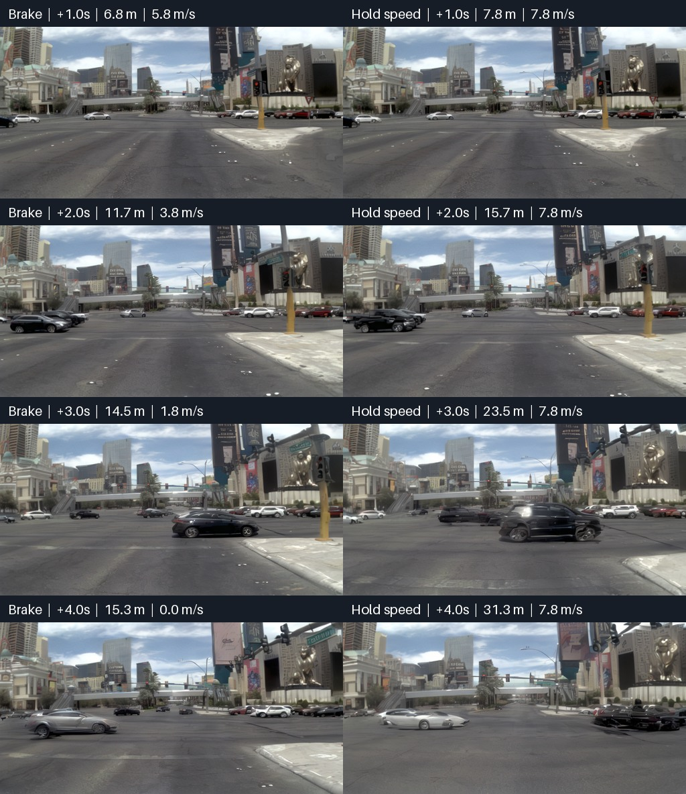

# NAVSIM 单场景对照 · 减速与保持速度

用发布版 DreamerAD 的 Epona 时空骨干和 DCAE 解码器，在 NAVSIM `navmini` 样本 `3f12b84004b15310` 上生成两组前视预测。两个分支共用四张 `CAM_F0` 历史帧、历史位姿、随机种子 `1234` 和模型权重。每个分支以 2 Hz 生成 8 张未来帧。比较视频左侧是减速，右侧是匀速，表头的距离与速度来自输入轨迹。



[逐帧对照视频](comparison.mp4) · [逐帧数值与运行环境](result.json) · [样本元数据](scene.json)

## 结果

| t = 4.0 s 的轨迹条件 | 纵向位移 | 末速度 |
|---|---:|---:|
| 减速 | 15.34 m | 0.00 m/s |
| 保持速度 | 31.33 m | 7.83 m/s |

第 3 秒起，匀速分支的视点明显更靠前，右侧路缘和信号灯杆更早移出画面边缘。两组生成画面的平均绝对 RGB 差值从第 0.5 秒的 1.46 上升到第 4 秒的 27.45（量程 0–255）。匀速分支的横穿车辆后段出现重影和形状变形，车辆外观与互动细节的可信度有限。

## 实验设置

初始纵向速度取样本锚点记录的 7.8322 m/s。两条轨迹沿锚点航向直行，匀速轨迹使用 0 m/s²，减速轨迹使用 −2 m/s² 并在速度降到零后保持停止。DreamerAD 使用连续自车位姿的相对平移和转角作为条件，每帧 4 个 DiT 采样步。两次推演前重置同一随机种子，脚本校验两次推演结束后的 CUDA 随机状态一致。

实验只观测一条记录上的两种模型预测。车距和物体外观是生成画面，另一条轨迹在真实道路上的后果没有对应观测真值。逐帧平均 RGB 差值衡量两个视频之间的差异，驾驶质量和安全表现需要独立评测。

## 复现

1. 检出 [DreamerAD 源码](https://github.com/pengxuanyang/DreamerAD/tree/9109b5ed2aa2b86cf73f3fb29826525f0674c59f)，按其环境说明安装 CUDA PyTorch 和运行依赖。运行 `prepare_scene.py` 还需要 NumPy、SciPy 和 PyYAML。
2. 下载 [DreamerAD RL 权重](https://huggingface.co/pengxuanyang/DreamerAD/blob/43efb5d8ce96010ee862a3000be720a95cf68acb/best_rl) 和 [Epona DCAE 权重](https://huggingface.co/Kevin-thu/Epona/blob/ebeed5ad07b1d3dac5e0202417971690ffdf2b29/dcae_td_20000.pkl)。
3. 在 [OpenScene v1.1](https://huggingface.co/datasets/OpenDriveLab/OpenScene/tree/a76f840b65e972bc45e56c2adced897498e9a026/openscene-v1.1) 下载 `openscene_metadata_mini.tgz`、`openscene_sensor_mini_0-31.json` 和 `openscene_sensor_mini_camera/openscene_sensor_mini_camera_5.tgz`。第 5 分片的前 160 MiB 已包含这个样本的四张图。

```bash
python prepare_scene.py \
  --source /path/to/DreamerAD \
  --metadata openscene_metadata_mini.tgz \
  --camera-archive openscene_sensor_mini_camera_5.tgz \
  --shard-index-file openscene_sensor_mini_0-31.json \
  --shard-index 5 \
  --token 3f12b84004b15310 \
  --output input

python compare.py \
  --source /path/to/DreamerAD \
  --scene input/scene.json \
  --checkpoint best_rl \
  --vae dcae_td_20000.pkl \
  --output result
```

| 权重 | SHA-256 |
|---|---|
| DreamerAD `best_rl` | `28889fd8cf97f76e6b98d68422b6c3f191b80f930864a3ba9fbaa65c7f8b5289` |
| Epona `dcae_td_20000.pkl` | `aa3bda2db0c8aed2da4bc1d2e1c6ca5c2d28cdbf84dab79c6b899660d0741258` |

数据来源为 OpenDriveLab 的 [OpenScene](https://huggingface.co/datasets/OpenDriveLab/OpenScene)，基于 nuPlan，数据采用 [CC BY-NC-SA 4.0](https://creativecommons.org/licenses/by-nc-sa/4.0/)。视频与对照图为基于该样本生成的研究衍生物，按同一许可分享。
